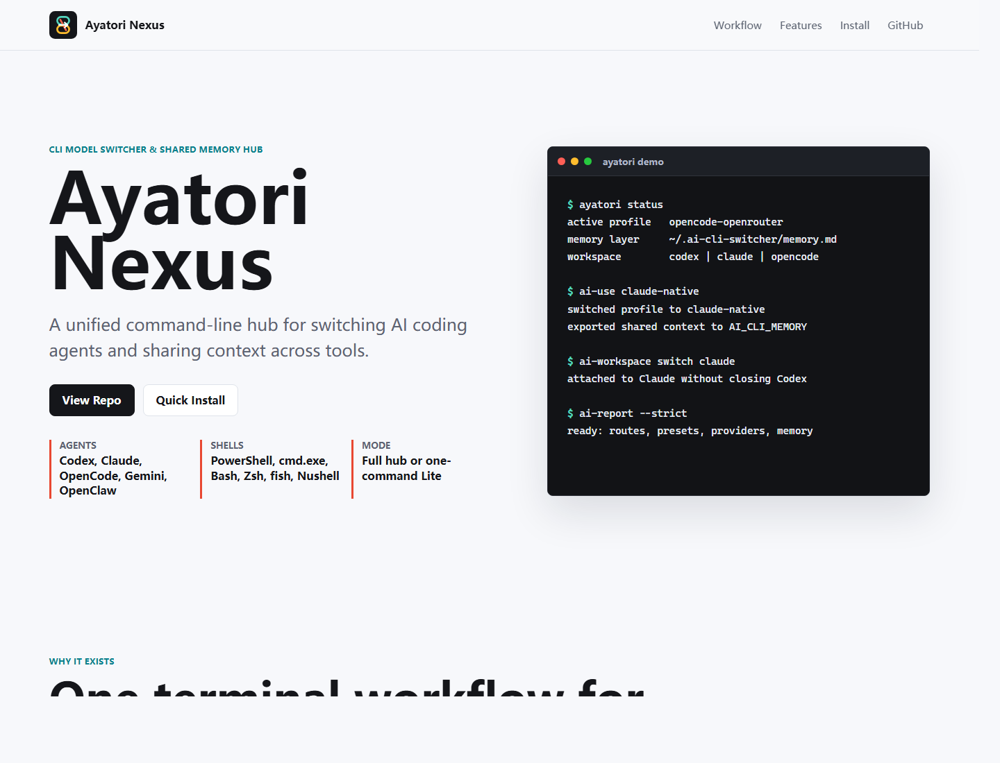
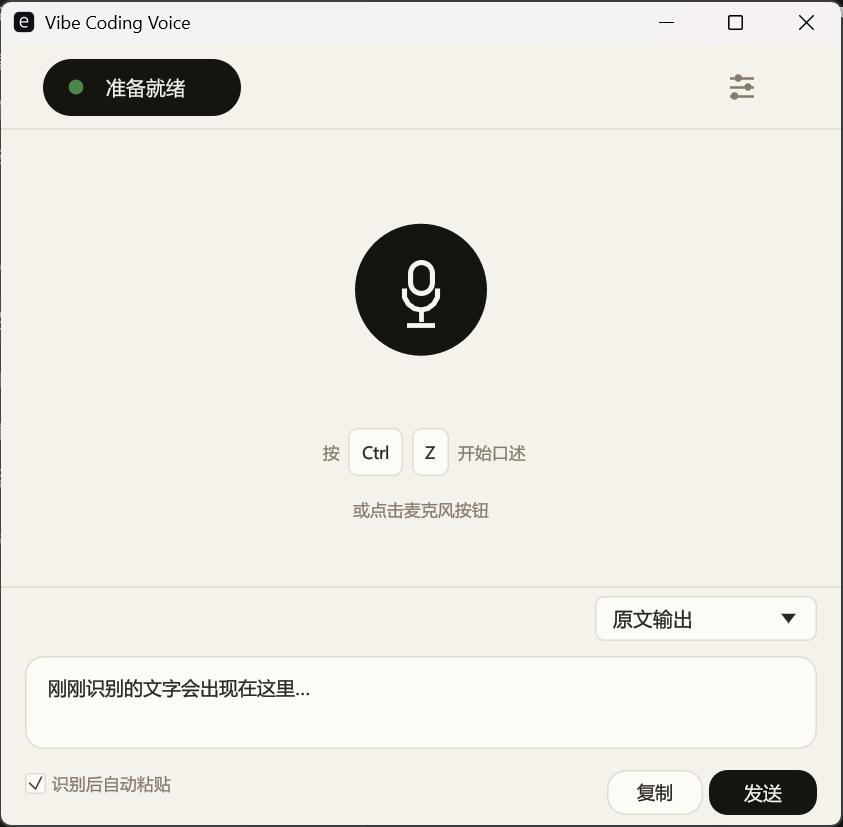

# Hi, I'm Yuxuan Sun

I build AI tools for coding, learning, and creative work. My current focus is on **coding agents**, **voice interfaces**, and **local-first workflows** — making useful AI capabilities easier to work with.

I work at the intersection of software engineering and human-computer interaction: turning model capabilities into tools with clear workflows, useful feedback, and room for human judgment.

[Website](https://yuxuansun.netlify.app) · [Email](mailto:albertexert@gmail.com) · [Explore projects](#more-to-explore) · [All repositories](https://github.com/UtenKekkoDev?tab=repositories)

## On the workbench

<table>
<tr>
<th width="34%" align="left">Currently building</th>
<th width="32%" align="left">Recent releases</th>
<th width="34%" align="left">Notes &amp; guides</th>
</tr>
<tr>
<td valign="top">

<a href="https://github.com/UtenKekkoDev/cli-model-switcher"><strong>CLI Model Switcher</strong></a> Switch coding-agent profiles, share context, and carry workflows across tools and models. Python · CLI · Shared memory

<a href="https://github.com/UtenKekkoDev/vibe-coding-voice"><strong>Vibe Coding Voice</strong></a> Dictate prompts and code changes on Windows, with local SenseVoice or optional online Qwen-ASR. Rust · egui · Alpha

<a href="https://github.com/UtenKekkoDev/AIBILI"><strong>AI Bili Checker</strong></a> Evaluate Bilibili learning videos, capture useful material, and connect it to Obsidian. Python · Flask · PySide6 · Prototype

</td>
<td valign="top">
<!-- releases:start -->

<a href="https://github.com/UtenKekkoDev/cli-model-switcher/releases/tag/v0.4.0"><strong>CLI Model Switcher v0.4.0</strong></a> 2026-05-30

<a href="https://github.com/UtenKekkoDev/vibe-coding-voice/releases/tag/v0.1.0-alpha.7"><strong>Vibe Coding Voice v0.1.0-alpha.7</strong></a> 2026-05-06

<!-- releases:end -->

Latest published version per project. Dates in Pacific Time.

</td>
<td valign="top">

<a href="https://github.com/UtenKekkoDev/cli-model-switcher/blob/main/docs/REFERENCE_ANALYSIS.md"><strong>Designing a CLI agent tool</strong></a> Design notes on configuration, policy, and reusable workflows.

<a href="https://github.com/UtenKekkoDev/vibe-coding-voice/blob/main/docs/MODELS.zh-CN.md"><strong>Setting up voice models</strong></a> Local SenseVoice setup and speech model guidance.

<a href="https://github.com/UtenKekkoDev/AIBILI/blob/main/AGENT_SETUP.md"><strong>Running AI Bili Checker</strong></a> Agent setup and the local development workflow.

<a href="https://github.com/UtenKekkoDev/xs-skill/blob/main/references/revision.md"><strong>Fiction revision checklist</strong></a> Timelines, character knowledge, motivation, and continuity.

</td>
</tr>
</table>

## A closer look

<table>
<tr>
<th width="50%" align="left">Ayatori Nexus / CLI Model Switcher</th>
<th width="50%" align="left">Vibe Coding Voice</th>
</tr>
<tr>
<td align="center" valign="top">
 
Project demo page
</td>
<td align="center" valign="top">
 
Windows app preview
</td>
</tr>
<tr>
<td valign="top">

For working across several coding agents without rebuilding your setup each time.

<ul><li>Switch agent and provider profiles.</li><li>Reuse shared context and handoff templates.</li><li>Check configuration and move portable state between machines.</li></ul>
<a href="https://github.com/UtenKekkoDev/cli-model-switcher">Source &amp; setup</a> · <a href="https://github.com/UtenKekkoDev/cli-model-switcher/releases">Releases</a>
</td>
<td valign="top">

For speaking through prompts and code changes, especially Chinese and mixed-language dictation.

<ul><li>Start and stop recording with a global shortcut.</li><li>Choose local or online transcription.</li><li>Edit, copy, or send the resulting text.</li></ul>
<a href="https://github.com/UtenKekkoDev/vibe-coding-voice/releases">Alpha downloads</a> · <a href="https://github.com/UtenKekkoDev/vibe-coding-voice/blob/main/docs/MODELS.zh-CN.md">Model setup</a>
</td>
</tr>
</table>

## Codex activity

Local Codex activity · Costs are API-equivalent estimates, may exclude unpriced models, and are not subscription charges.

## More to explore

### Presentations & creative workflows

- **[DOM Native PPTX](https://github.com/UtenKekkoDev/dom-native-pptx)** — convert slide-safe HTML into native, editable PowerPoint objects, with explicit validation and raster policies. **Beta.** [Quick start](https://github.com/UtenKekkoDev/dom-native-pptx#five-minute-quick-start).
- **[XS Skill](https://github.com/UtenKekkoDev/xs-skill)** — a Chinese short-fiction writing skill for story planning, revision, and continuity checks. [Writing methods](https://github.com/UtenKekkoDev/xs-skill/blob/main/references/writing-methods.md).
- **[XHS AI Content Publisher](https://github.com/UtenKekkoDev/xhs-ai-content-publisher)** — turn public sources and supplied notes into source-linked Xiaohongshu and WeChat drafts, with review and visual-card planning.
- **[AI Comic](https://github.com/UtenKekkoDev/AI-COMIC)** — a prototype connecting scripts, storyboards, character cards, and comic layouts.

### Desktop tools & knowledge capture

- **[Fairy DSH for Windows](https://github.com/UtenKekkoDev/Fairy-DSH-Windows)** — a Windows adaptation of [Fairy DSH](https://github.com/Chengzhibense/Fairy-DSH), with an isolated runtime, browser tools, and local GPT-SoVITS voice.
- **[Bilibili–Obsidian Clipper](https://github.com/UtenKekkoDev/Bilibili-Obsidian-Clipper)** — a fork connecting video subtitles with Markdown and Obsidian; part of my exploration of local knowledge workflows.

### HCI & playful experiments

- **[Carbon Clash](https://github.com/UtenKekkoDev/carbon-clash-ai-citizens)** — a civic strategy game exploring environmental trade-offs, with optional AI integration.

## What I care about

- **Clear agent interactions.** Make task state, progress, errors, and recovery understandable.
- **Repeatable workflows.** Turn useful experiments into tools that can be configured, reused, and maintained.
- **Local ownership.** Keep data portable and make the choice between local and online processing explicit.
- **Human control.** Give people useful feedback and a way to inspect, edit, or override the result.

## Background & tools

- MSc Human-Computer Interaction — **Newcastle University**
- BSc Computer Science — **Heriot-Watt University**

I work with `Python`, `TypeScript`, `React`, `Node.js`, `Rust`, `Tauri`, and `Shell`, across CLI utilities, desktop apps, browser tools, and AI-assisted creative workflows.

For project questions, open an issue in the relevant repository. For a conversation about AI tools, agent UX, or creative workflows, [send me an email](mailto:albertexert@gmail.com).

Personal profile card

