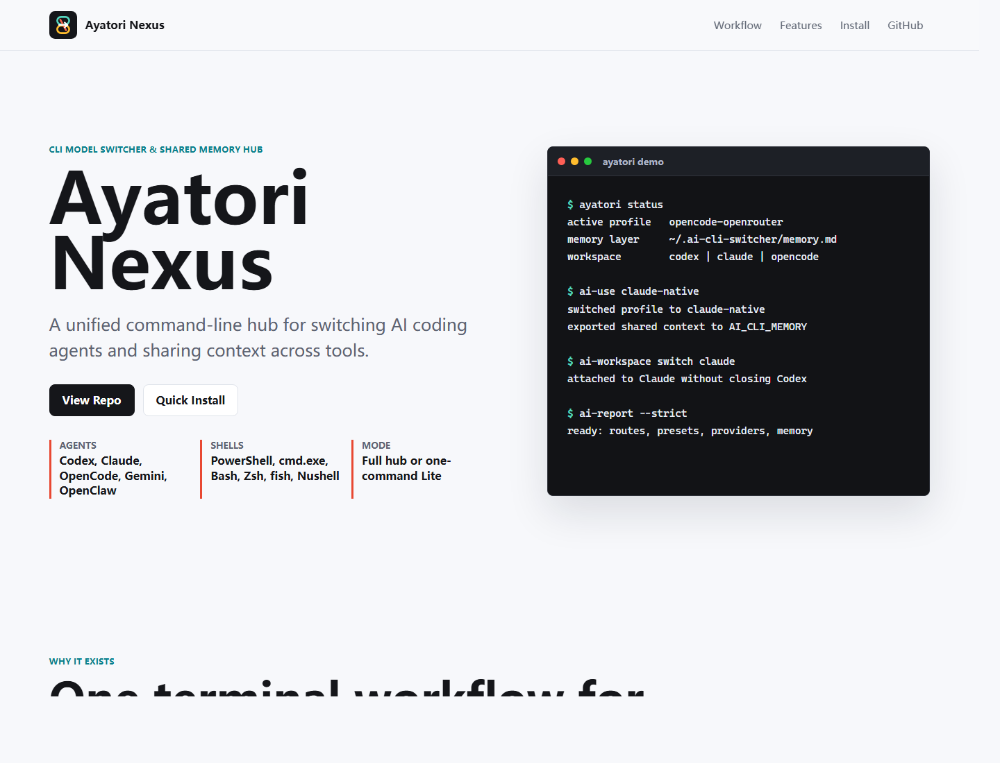

# Hi, I'm Yuxuan Sun

I build **AI tools, agent workflows, and local-first desktop apps** for coding, research, and creative work.

My background is in software engineering and human-computer interaction. I care about turning model capabilities into useful workflows: clear steps, evidence people can inspect, and results they can edit and reuse.

[Website](https://yuxuansun.netlify.app) · [Email](mailto:albertexert@gmail.com) · [Explore projects](#more-to-explore) · [All repositories](https://github.com/UtenKekkoDev?tab=repositories)

## Featured projects

<table>
<tr>
<th width="50%" align="left">Ayatori Nexus / CLI Model Switcher</th>
<th width="50%" align="left">Marlin Reader</th>
</tr>
<tr>
<td align="center" valign="top">
 
Project demo page
</td>
<td align="center" valign="top">
 
Desktop editor · Light theme
</td>
</tr>
<tr>
<td valign="top">

Keep a reusable setup across command-line coding agents.

<ul><li>Switch agent and provider profiles.</li><li>Share context and handoff templates.</li><li>Check configuration and export portable state.</li></ul>
<a href="https://github.com/UtenKekkoDev/cli-model-switcher">Source &amp; setup</a> · <a href="https://utenkekkodev.github.io/cli-model-switcher/">Demo</a>
</td>
<td valign="top">

Edit project documentation in a local desktop workspace.

<ul><li>Read and edit Markdown with live preview.</li><li>Edit preview blocks and table cells.</li><li>Export Markdown or HTML, and print to PDF.</li></ul>
<a href="https://github.com/UtenKekkoDev/marlin-reader">Source &amp; setup</a> · <a href="https://github.com/UtenKekkoDev/marlin-reader#preview-editing">Preview editing</a>
</td>
</tr>
</table>

## New in Windows voice tools

- **[Vibe Voice Lite](https://github.com/UtenKekkoDev/vibe-voice-lite)** builds on Vibe Coding Voice. Hold Right Ctrl to dictate into a Windows text field, or use the interview mode to turn a spoken feature request into agreed requirements and open questions. [Windows preview downloads](https://github.com/UtenKekkoDev/vibe-voice-lite/releases) · [English guide](https://github.com/UtenKekkoDev/vibe-voice-lite/blob/main/README.en.md)
- **[Vibe Desktop Assistant](https://github.com/UtenKekkoDev/vibe-desktop-assistant)** extends Vibe Voice Lite as a separate Windows app. Hold F9 to name a control in the active window or dictate a draft into the current chat. For supported actions, the assistant reads back the field or checks the conversation for a matching message. [Source and setup](https://github.com/UtenKekkoDev/vibe-desktop-assistant#本机运行)

## On the workbench

<table>
<tr>
<th width="34%" align="left">Recent projects</th>
<th width="33%" align="left">Selected tools</th>
<th width="33%" align="left">Notes &amp; guides</th>
</tr>
<tr>
<td valign="top">

<a href="https://github.com/UtenKekkoDev/public-lead-research"><strong>Public Lead Research</strong></a> Turn a business brief into LinkedIn prospect research, evidence checks, and reviewable candidate exports. Agent skill · Research workflow

<a href="https://github.com/UtenKekkoDev/xs-skill"><strong>XS Skill</strong></a> Plan, write, and revise Chinese short fiction, with checks for motivation, continuity, and payoff. Writing skill · Includes attributed reference material

<a href="https://github.com/UtenKekkoDev/Fairy-DSH-Windows"><strong>Fairy DSH for Windows</strong></a> My Windows installation and deployment adaptation of <a href="https://github.com/Chengzhibense/Fairy-DSH">Fairy DSH</a>, with an isolated runtime, browser tools, and local voice. Upstream adaptation · Windows

</td>
<td valign="top">

<a href="https://github.com/UtenKekkoDev/cli-model-switcher"><strong>CLI Model Switcher</strong></a> Switch coding-agent profiles and providers, reuse shared context, and move configurations between machines. Python · CLI · Shared memory

<a href="https://github.com/UtenKekkoDev/marlin-reader"><strong>Marlin Reader</strong></a> A local Markdown editor with live preview, editable preview blocks, and README-focused tools. Tauri · React · Desktop MVP

<a href="https://github.com/UtenKekkoDev/vibe-coding-voice"><strong>Vibe Coding Voice</strong></a> Dictate coding prompts on Windows using local SenseVoice or optional online Qwen-ASR. Rust · egui · Alpha

</td>
<td valign="top">

<a href="https://github.com/UtenKekkoDev/public-lead-research/blob/main/references/intake.md"><strong>From a brief to research criteria</strong></a> Clarify the offer, target audience, market, and evidence needed before searching.

<a href="https://github.com/UtenKekkoDev/xs-skill/blob/main/references/revision.md"><strong>Fiction revision checklist</strong></a> Check timelines, character knowledge, motivation, and continuity.

<a href="https://github.com/UtenKekkoDev/cli-model-switcher/blob/main/docs/REFERENCE_ANALYSIS.md"><strong>Designing a CLI agent tool</strong></a> Design notes on configuration, policy, and reusable workflows.

</td>
</tr>
</table>

## More to explore

### Research & creative workflows

- **[Public Lead Research](https://github.com/UtenKekkoDev/public-lead-research)** — guided intake, LinkedIn discovery, source verification, and CSV/Markdown exports. [Workflow](https://github.com/UtenKekkoDev/public-lead-research#工作流程).
- **[XS Skill](https://github.com/UtenKekkoDev/xs-skill)** — a Chinese short-fiction writing and revision workflow, with attributed writing references and practical continuity checks. [Writing methods](https://github.com/UtenKekkoDev/xs-skill/blob/main/references/writing-methods.md).
- **[XHS AI Content Publisher](https://github.com/UtenKekkoDev/xhs-ai-content-publisher)** — turn public sources and supplied notes into source-linked Xiaohongshu and WeChat drafts, with review and visual-card planning.

### Desktop tools & learning

- **[Marlin Reader](https://github.com/UtenKekkoDev/marlin-reader)** — a local README editor and Markdown viewer, with experimental editing directly in the preview.
- **[Vibe Coding Voice](https://github.com/UtenKekkoDev/vibe-coding-voice)** — Windows dictation for Chinese and mixed-language coding prompts. **Alpha.** [Voice model setup](https://github.com/UtenKekkoDev/vibe-coding-voice/blob/main/docs/MODELS.zh-CN.md).
- **[AI Bili Checker](https://github.com/UtenKekkoDev/AIBILI)** — a prototype for evaluating Bilibili learning videos and connecting useful material to Obsidian.

### HCI & playful experiments

- **[Carbon Clash](https://github.com/UtenKekkoDev/carbon-clash-ai-citizens)** — a civic strategy game exploring environmental trade-offs, with optional AI integration.

### Upstream adaptation

- **[Fairy DSH for Windows](https://github.com/UtenKekkoDev/Fairy-DSH-Windows)** — my Windows installation and deployment work based on [Chengzhibense/Fairy-DSH](https://github.com/Chengzhibense/Fairy-DSH). Includes an isolated runtime, browser tools, and local GPT-SoVITS voice. [Attribution and modification notices](https://github.com/UtenKekkoDev/Fairy-DSH-Windows/blob/main/NOTICE).

## Release versions

<!-- releases:start -->

<a href="https://github.com/UtenKekkoDev/cli-model-switcher/releases/tag/v0.4.0"><strong>CLI Model Switcher v0.4.0</strong></a> 2026-05-30

<a href="https://github.com/UtenKekkoDev/vibe-coding-voice/releases/tag/v0.1.0-alpha.7"><strong>Vibe Coding Voice v0.1.0-alpha.7</strong></a> 2026-05-06

<!-- releases:end -->

Latest published release for the tracked projects: CLI Model Switcher, Vibe Coding Voice, and AI Bili Checker. A release date is separate from ongoing repository activity. Dates in Pacific Time.

## What I care about

- **Clear agent interactions.** Make task state, progress, errors, and recovery understandable.
- **Repeatable workflows.** Turn useful experiments into tools that can be configured, reused, and maintained.
- **Local ownership.** Keep data portable and make the choice between local and online processing explicit.
- **Human control.** Give people useful feedback and a way to inspect, edit, or override the result.

## Codex activity

Local Codex activity · Costs are API-equivalent estimates, may exclude unpriced models, and are not subscription charges.

## Background & tools

- MSc Human-Computer Interaction — **Newcastle University**
- BSc Computer Science — **Heriot-Watt University**

I work with `Python`, `TypeScript`, `React`, `Node.js`, `Rust`, `Tauri`, and `Shell`, across CLI utilities, desktop apps, browser tools, and AI-assisted creative workflows.

For project questions, open an issue in the relevant repository. For a conversation about AI tools, agent UX, or creative workflows, [send me an email](mailto:albertexert@gmail.com).

Personal profile card

